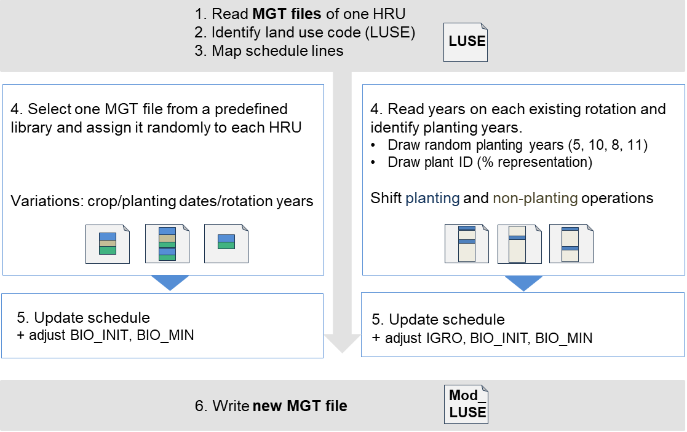

# Dynamic land-use and plantation management in SWAT 2012

1.This repository provides the input data and results of the workflow used to (1) generate spatially explicit transition maps of forestry change across the Tacuarembó River Catchment (TRC) and (2) implement dynamic land-use and staggered plantations in SWAT through automated modification of HRU management files (.mgt) using RStudio.

2. Also, it contains the GEE codes used to
   a.Find polygons in MAPBIOMAS that are classified as forest (silvopastoral) and pasture from 2003 o 2024 -
   b. Exports polygon-mean and centroid-pixel MODIS signal and match patchid with Subbasin location number

The code of this repository was originally developed by myself and using the assistance of ChatGPT (OpenAI) for code structuring, cleaning and debugging.

The workflow was developed for the Tacuarembó River Catchment (TRC), Uruguay. The following description aims to document in detail each step of workflow 1.

The core workflow has two stages:
1.2 **Spatial land-use transition preparation:** preparation of temporally explicit land-use classes and their links to SWAT management types.
1.2. **Dynamic management operations in space and time:** modification of SWAT HRU management files (`.mgt`) to represent staggered plantations.

1. Spatial land-use transitions (Workflow 1)
1.1 Documents the preparation of a multi-year land-use transition map using:
- General land-use information (2015).
- Forestry maps for 2004, 2018 and 2021.
- Forestry-priority soils.

The process includes harmonising the land-use attributes, combining time slices using QGIS union operations, assigning temporal transition codes, generating 13 final land-use classes, and linking those classes to SWAT management types. The full spatial input data can be found in: <https://doi.org/10.6084/m9.figshare.30856865>

1.2  Dynamic SWAT 2012 management (Workflow 2)
A. Dynamic management changes
This changes management schedules while retaining the relevant SWAT land-use type. We use management-specific scripts and embedded operation-schedule template fro each land use category (LUSE). Depending on the land-use, the scripts work with fields such as rotation operational length (`NROT`), initial biomass (`BIO_INIT`) and minimum biomass (`BIO_MIN`).

B. Staggered plantation establishment
This stage redistributes planting operations among years so that eligible HRUs do not all begin plantation rotations simultaneously. The planting-position scripts parse the `.mgt` operation schedule into yearly blocks, identify planting operations, reassign planting timing according to the target-year rules in each script, and write modified management files. The objective is to retain the sequence of the remaining rotation operations while varying plantation establishment timing.

The precise target years, biomass mappings, randomisation and file-writing behaviour are defined in the individual scripts for each LUSE. 

### Scripts 
| Script | Purpose |
|---|---|
| `scripts/mgt_AGRI.R` | Agricultural management templates, management-field replacements and a rice-specific branch for selected subbasins. |
| `scripts/mgt_FORD.R` | Three `FORD` management-schedule variants and associated management-field updates. |
| `scripts/mgt_FORDV.R` | Three `FODV` management-schedule variants and associated management-field updates. |
| `scripts/mgt_FORQ.R` | Three `FORQ` management-schedule variants and associated management-field updates. |
| `scripts/mgt_EUCA_change_planting_position.R` | Redistribution of Eucalyptus planting dates in `.mgt` schedules. |
| `scripts/mgt_pine_change_planting_position.R` | Redistribution of Pine planting dates in `.mgt` schedules. |
| `scripts/mgt_pine_scnearios.R` | Example of Pine scenario preparation, including `ESC` to `PINE` text changes and related `.mgt`, `.hru` and `.gw` file handling. |
| `scripts/mgt_changeCN.R` | Additional CN2 lookup / update utility after changeing LUSE |
| `GEE_scripts/Patch_locations` | Uses MapBiomas Pampa annual classifications to identify persistent plantation and pasture pixels over the configured period and export masks. |
| `GEE_scripts/PatchFinder` | Creates patch polygons and extracts LAI / ET time series for polygon means and centroid pixels. |

